# DE Dojo — Documentación técnica y de arquitectura

> Referencia completa del repositorio `crabb-beltran/de-dojo`: qué es, con qué
> está construido, cómo está organizado y cómo funciona por dentro. Los
> diagramas son [Mermaid](https://mermaid.js.org/) y GitHub los renderiza
> automáticamente en esta página.

---

## 1. Qué es

**DE Dojo** es una plataforma web de entrenamiento para entrevistas de **Data
Engineering**. Combina dos cosas:

- Una **guía de entrevista** extensa y orientada a producción (17 secciones
  temáticas, 82+ subtemas, 9 diagramas): SQL avanzado, Snowflake, dbt, AWS,
  modelado, arquitectura lakehouse, NoSQL, estadística, seguridad y tendencias.
- Un **dojo de ejercicios ejecutables** con corrección automática por *test
  cases* reales: **189 ejercicios** (50 SQL · 53 Python · 76 quiz · 10 abiertas)
  repartidos en 17 categorías, con modos Práctica, Examen cronometrado y Stats.
  Los **103 ejecutables** (SQL + Python) son el objeto evaluable del proyecto de
  grado UNAD (edición académica, §4.1).

Todo es una **página estática de un solo archivo** (`index.html`, ~930 KB, ~9.900 líneas) que
se despliega gratis en GitHub Pages. El SQL y el Python **se ejecutan en el
navegador del usuario** (WebAssembly), sin backend obligatorio.

| Aspecto | Valor |
|---|---|
| Tipo | SPA estática de un solo archivo, sin framework ni build step |
| Ejercicios | 189 (50 SQL · 53 Python · 76 quiz · 10 abiertas IA) · 17 categorías; edición académica: 179 (sin abiertas) |
| Guía | 21 secciones `<h2>` · 82 subsecciones `<h3>` · bilingüe ES/EN |
| Ejecución | SQL vía `sql.js` (SQLite WASM) · Python vía Pyodide · en el cliente |
| Persistencia | localStorage + sync a Supabase (Postgres, RLS) · telemetría por intento + vista `v_attempts` |
| Hosting | GitHub Pages (producción, gratis) · Cloudflare Pages documentado como alternativa · CI en GitHub Actions |
| Tutor IA | Opcional, vía Cloudflare Worker (la API key nunca toca el cliente) |

---

## 2. Lenguajes y tecnologías

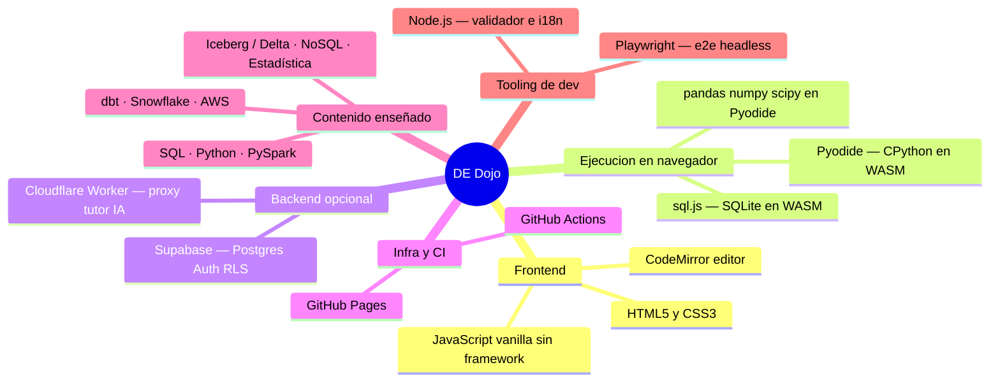

| Capa | Tecnología | Rol |
|---|---|---|
| **UI** | HTML5 + CSS3 (variables, grid, theming claro/oscuro) | Estructura y diseño responsive, sin dependencias de CSS |
| **Lógica** | **JavaScript vanilla** (ES2020+, sin framework ni bundler) | Toda la app: routing, estado, i18n, grading, cuentas |
| **Editor** | CodeMirror | Resaltado de sintaxis SQL/Python |
| **Motor SQL** | **sql.js** (SQLite compilado a WebAssembly) | Ejecuta las queries del usuario contra tablas sembradas |
| **Motor Python** | **Pyodide** (CPython en WASM) + pandas, numpy, scipy, sqlite3 | Ejecuta el código Python y sus tests |
| **Cuentas / sync** | **Supabase** (Postgres, GoTrue Auth, Row-Level Security) vía REST | Login, aprobación y respaldo de progreso entre dispositivos |
| **Tutor IA** (opcional) | **Cloudflare Worker** → API Gemini (Google) | Proxy serverless para que la API key quede del lado servidor |
| **CI/CD** | **GitHub Actions** + **GitHub Pages** | Validación de contenido y despliegue automático |
| **Dev tooling** | **Node.js** (validador, remap de i18n), **Playwright** (e2e) | Calidad de contenido y pruebas de navegador |

> **Nota de diseño:** cero dependencias en runtime más allá de las tres
> librerías WASM/editor que se cargan desde CDN (sql.js, Pyodide, CodeMirror).
> No hay `node_modules` en producción — `test/node_modules` es solo para el
> tooling de desarrollo.

---

## 3. Estructura del repositorio

```
de-dojo/
├── index.html                 ← LA APP COMPLETA (UI + lógica + guía + 189 ejercicios)
├── README.md                  ← visión general, features, cómo correr
├── CHANGELOG.md               ← versiones (1.0.0 base · 1.1.x incremento TRL5)
├── LICENSE                    ← MIT
│
├── assets/                    ← branding e íconos
│   ├── de-dojo-icon.png           logo (tema claro)
│   ├── de-dojo-icon-dark.png      logo (tema oscuro)
│   ├── favicon.ico / favicon-16/32.png / apple-touch-icon.png
│   └── og-image.png               preview para redes sociales
│
├── docs/                      ← documentación y assets de la guía
│   ├── ARCHITECTURE.md            (este archivo)
│   ├── ACCOUNTS.md               setup de cuentas, aprobación y cobro (Supabase)
│   ├── AUTHORING.md              cómo añadir ejercicios al array EX
│   ├── VALIDATION.md             protocolo de validación con usuarios (SUS + telemetría)
│   └── assets/guide-01..09.jpg   diagramas embebidos en la guía
│
├── workers/ai-tutor/          ← proxy serverless del tutor IA (opcional)
│   ├── worker.js                 Cloudflare Worker (inyecta la API key)
│   ├── wrangler.toml             config de despliegue
│   └── README.md
│
├── test/                      ← tooling de desarrollo (NO se despliega)
│   ├── validate.mjs              gate de contenido (corre en CI)
│   ├── guide_i18n.mjs            remap de traducciones por texto
│   └── package.json              deps de dev (sql.js, node-html-parser)
│
└── .github/workflows/
    ├── validate.yml              CI: valida los 189 ejercicios en cada push
    └── pages.yml                 CD: despliega a GitHub Pages al mergear a main
```

### Anatomía de `index.html`

Aunque es un solo archivo, internamente está organizado en bloques claros:

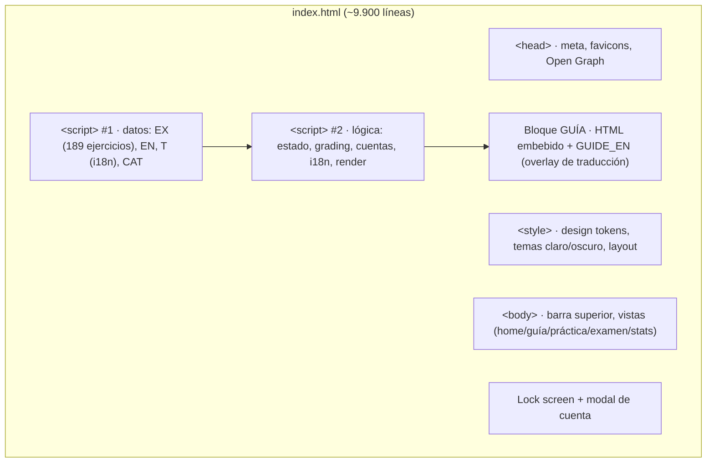

---

## 4. Arquitectura de ejecución

Lo distintivo: **no hay servidor de aplicación**. El navegador descarga el
archivo y ejecuta todo localmente; los servicios externos (Supabase, Worker)
son **opcionales y desacoplados**.

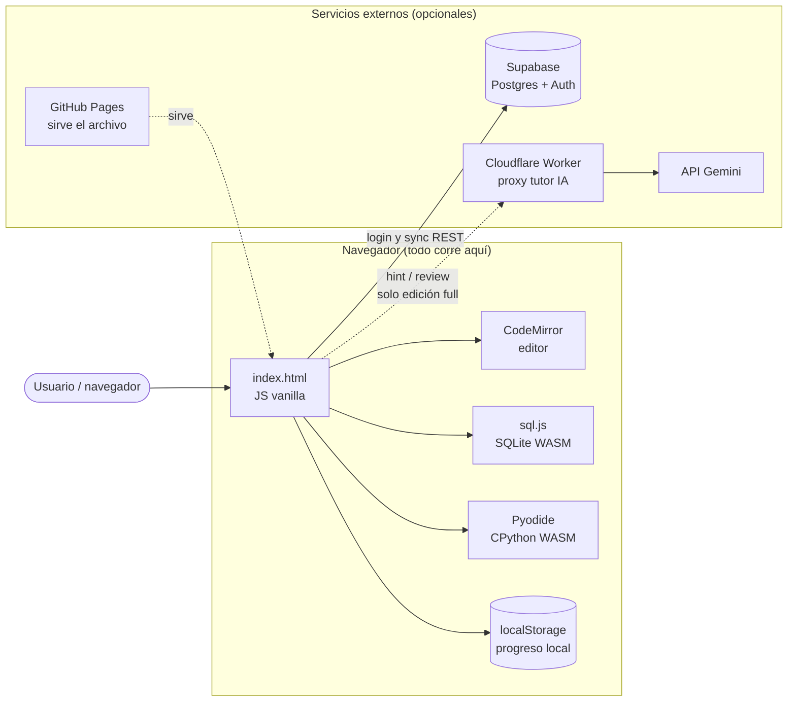

### 4.1 Componentes internos y su interacción

Dentro de `index.html` la lógica se organiza en módulos funcionales (no hay
bundler: son grupos de funciones sobre un estado global compartido). El
diagrama muestra quién llama a quién en un ciclo completo de uso.

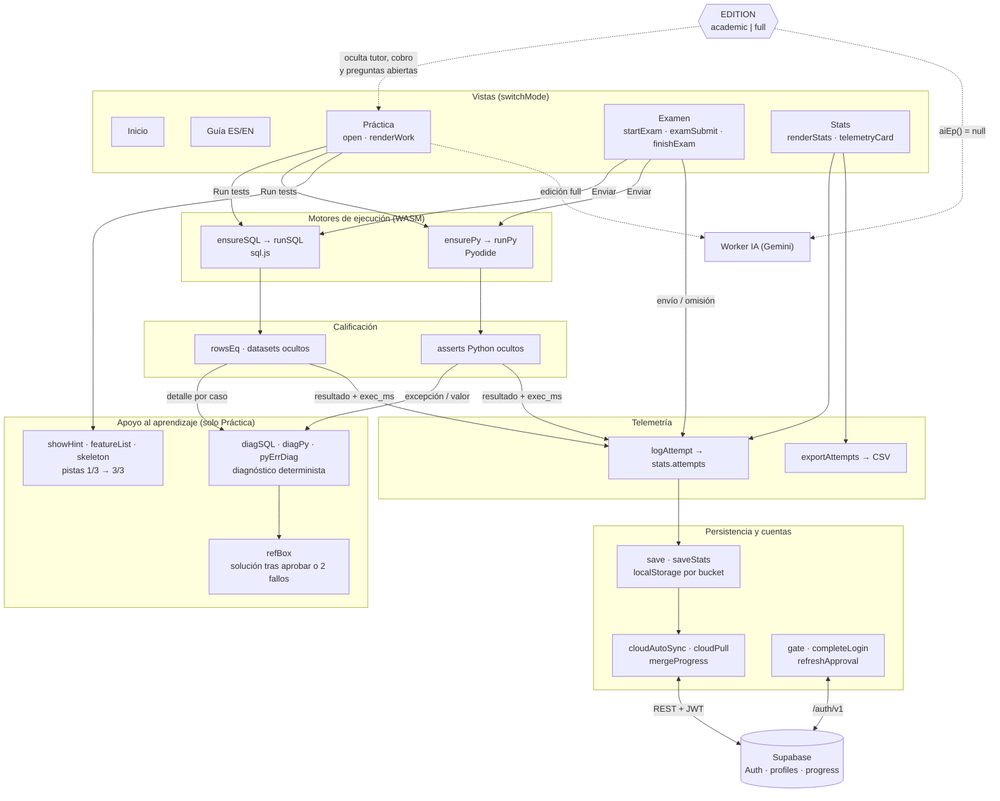

| Módulo | Responsabilidad | Entradas → Salidas |
|---|---|---|
| Vistas | Navegación y render de cada modo | acción del usuario → llamada al motor |
| Motores | Ejecutar código del usuario y referencia en el sandbox WASM | código + datasets → filas / resultado de asserts + `exec_ms` |
| Calificación | Comparar set-based (orden solo si la tarea lo exige) sobre 1+ datasets ocultos | filas usuario vs referencia → PASS/FAIL por caso |
| Apoyo al aprendizaje | Pistas derivadas de la solución de referencia, diagnóstico y solución condicionada | detalle del fallo → mensaje explicativo |
| Telemetría | Un evento compacto por intento, sin guardar el código | resultado + contexto → `stats.attempts` |
| Persistencia | Guardar local, sincronizar y combinar entre dispositivos | estado → `progress.data` (JSONB, RLS) |
| Cuentas | Sesión, aprobación del admin y OAuth PKCE | credenciales → JWT + `approved` |
| Edición | Recortar la superficie visible sin tocar el motor | `?edition=` / `DEFAULT_EDITION` → UI y banco filtrados |

### 4.2 Flujo de un intento en Práctica

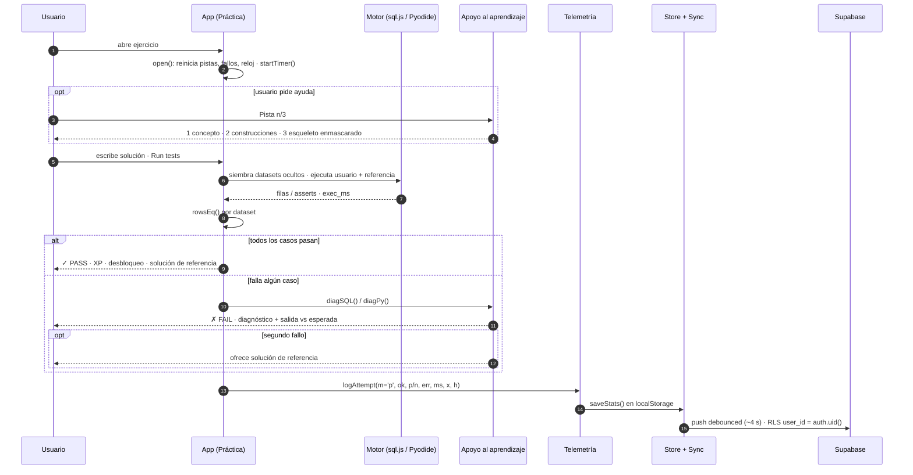

### 4.3 Flujo de un simulacro (Examen)

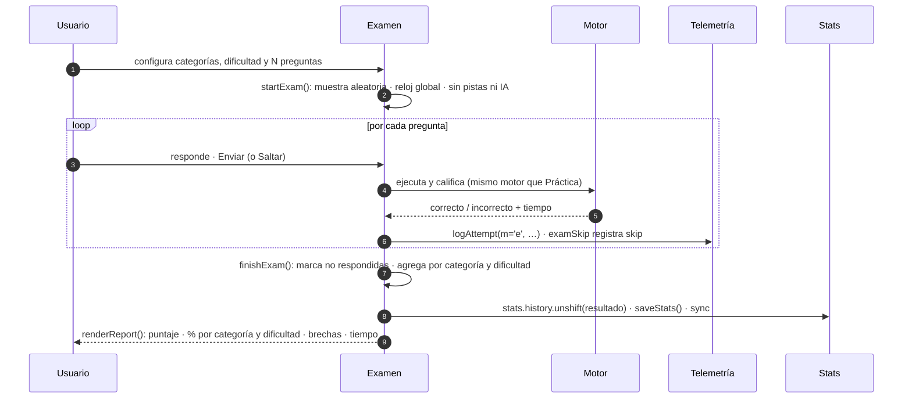

### 4.4 Apoyo al aprendizaje y telemetría (incremento 2026, TRL5)

Capa **aditiva** sobre el motor: no cambia cómo se califica un ejercicio.

| Req. | Qué hace | Dónde |
|---|---|---|
| RF07 | Pistas estáticas en 3 niveles: (1) concepto clave, (2) construcciones detectadas en la solución de referencia, (3) esqueleto con identificadores y literales enmascarados (`___`). Un ejercicio puede definir sus propias pistas con `hints:[…]` | `showHint()`, `featureList()`, `skeleton()` |
| RF08 | Diagnóstico determinista del fallo. SQL: sintaxis, columna o tabla inexistente, columnas, filas de más o de menos, orden, valores, falla solo en datasets ocultos. Python: tipo de excepción, tipo de dato, casos parciales. Tras aprobar (o tras 2 fallos) se ofrece la solución de referencia | `diagSQL()`, `diagPy()`, `pyErrDiag()`, `refBox()` |
| RF14 | Tiempo de ejecución del código del usuario (informativo: depende del equipo, no califica) | `runSQL()`, `runPy()` |
| RF15 | Un registro por intento en `stats.attempts`, sincronizado con la fila de progreso existente y exportable a CSV desde *Stats* | `logAttempt()`, `exportAttempts()` |

El **modo examen sigue sin ayudas**: no hay pistas, diagnóstico ni solución de referencia.

Esquema de un intento (claves cortas para no inflar el JSONB):

| Clave | Significado |
|---|---|
| `ts` | epoch ms |
| `id` / `k` / `kind` / `d` | ejercicio, categoría, tipo, dificultad |
| `m` | `p` práctica · `e` examen |
| `ok` / `p` / `n` | resultado global y casos aprobados/total |
| `err` | clase de diagnóstico (`syntax`, `nocol`, `more`, `hidden`, `KeyError`, `pytype`, …) |
| `ms` | tiempo en la tarea desde que se abrió el ejercicio |
| `x` | tiempo de ejecución del código del usuario (ms) |
| `h` | pistas estáticas usadas antes de este intento |

`mergeProgress()` une los intentos de varios dispositivos sin duplicar (`ts|id|m`) y conserva los últimos 2000.

#### Pipeline de telemetría hasta el análisis

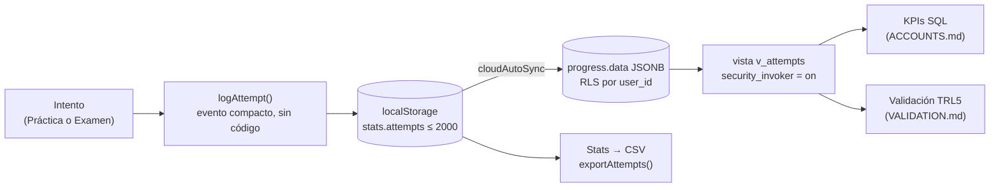

`v_attempts` desanida `data->'stats'->'attempts'` a filas
(`user_id, ts, exercise_id, category, kind, diff, mode, ok, passed, total,
diag, time_on_task_ms, exec_ms, hints`). Al ser `security_invoker`, un usuario
autenticado solo ve sus propios eventos; el análisis agregado se hace con el
rol de servicio desde el panel de Supabase.

### 4.5 Ediciones: una base de código, dos vistas

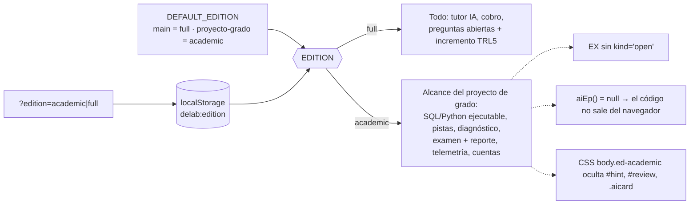

| Rama | Edición por defecto | Uso |
|---|---|---|
| `main` | `full` | Producción (GitHub Pages) |
| `proyecto-grado` | `academic` | Difiere de `main` en una línea (`DEFAULT_EDITION`) |
| `release/v1-baseline` | — | Línea base 1.0.0 congelada, previa al incremento |

Ambas ediciones ejecutan exactamente el mismo motor de calificación: la edición
solo recorta la superficie visible.

---

## 5. Modelo de datos y persistencia

Cada usuario tiene su **propio bucket** de progreso (`state` + `stats`). El
invitado usa un bucket local; una cuenta usa un bucket propio respaldado en la
nube. **Nunca se mezclan.**

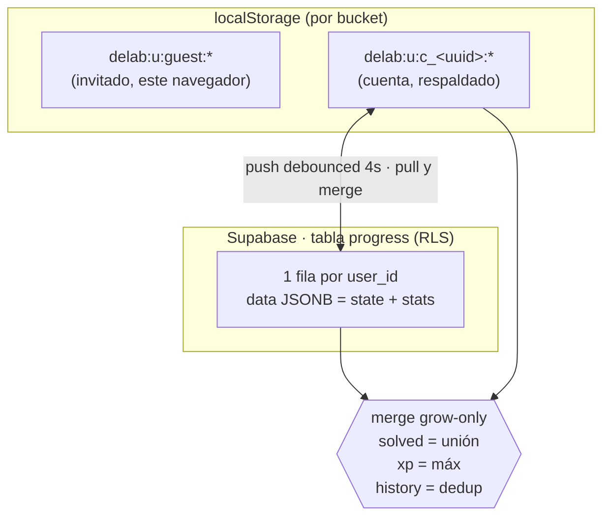

- **Offline-first:** localStorage es la fuente de verdad; la nube es respaldo.
- **Merge que solo crece:** al sincronizar, `solved` se une, `xp` toma el
  máximo y el historial se deduplica → dos dispositivos nunca se borran entre sí.
- **`state`** = `{ solved, xp, streak, lastDay }` · **`stats`** = `{ history[], attempts[] }`.
- **`attempts`** se combina por `ts|id|m` (sin duplicados) y conserva los últimos 2000 (§4.4).

---

## 6. Autenticación y control de acceso (base del cobro)

La app está **restringida a usuarios registrados y aprobados**. El candado del
cliente protege la experiencia; el flag `approved` y las políticas **RLS** del
servidor protegen la sincronización — un no-aprobado no puede leer/escribir
aunque manipule el cliente.

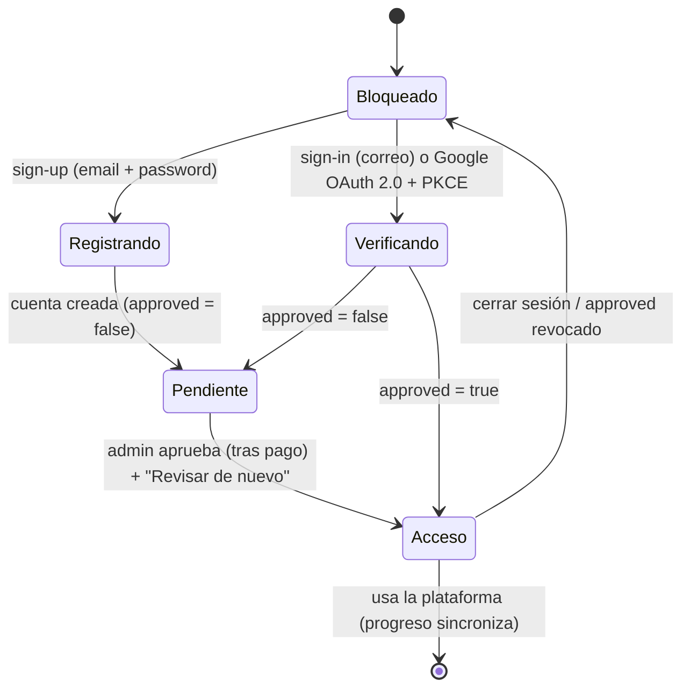

- **`profiles`** (tabla): `approved` lo controla el admin; los usuarios solo
  pueden **leer** su fila (sin políticas de escritura).
- **`progress`** (tabla): sus políticas RLS exigen `approved = true`.
- **Cobro:** aprobación manual, o un enlace de pago (`PAY_LINK`) en la pantalla
  de pendiente (Stripe Payment Links / Lemon Squeezy), o a futuro un webhook.
- **Google OAuth 2.0 + PKCE** (sin SDK): `signInGoogle()` redirige a `/auth/v1/authorize` con `code_challenge`; al volver, `handleOAuthCallback()` canjea el código en `/auth/v1/token?grant_type=pkce` y reutiliza el mismo camino de sesión que el login por correo (`completeLogin()`). Se activa con `AUTH_GOOGLE=true` después de configurar el proveedor.
- Detalle completo del setup SQL en [`ACCOUNTS.md`](./ACCOUNTS.md).

---

## 7. Internacionalización (ES/EN)

La app es bilingüe. La UI usa un diccionario `T`; los ejercicios un overlay
`EN` por id; y la **guía** usa un mecanismo especial: como es HTML estático
enorme, se traduce **por posición** con un overlay `GUIDE_EN` (1.608 entradas)
indexado al orden del documento.

El reto: al **insertar o reordenar** secciones de la guía, los índices se
desplazan y romperían la traducción. Se resuelve con un remap **por texto**
(`test/guide_i18n.mjs`), no por índice:

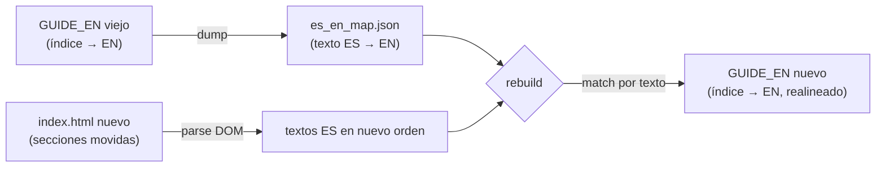

Así las traducciones existentes sobreviven cualquier inserción/reordenamiento;
el contenido nuevo sin traducir **degrada con gracia al español**.

---

## 8. CI/CD

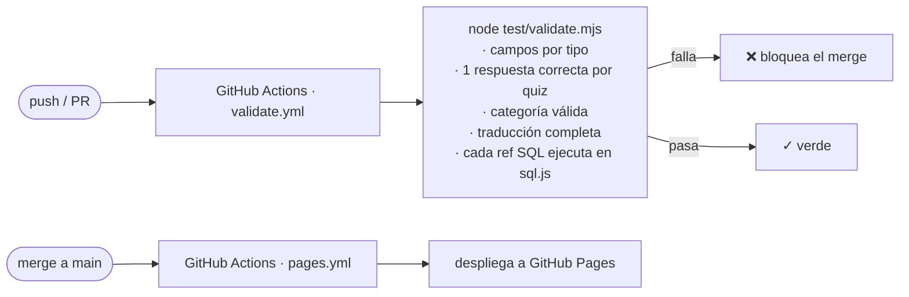

- **`validate.yml`** corre en cada push/PR: extrae `EX`/`EN` de `index.html` y
  valida estructura + ejecuta **cada query SQL de referencia** con sql.js. El
  contenido roto no llega a producción.
- **`pages.yml`** publica el sitio al mergear a `main`.

---

## 9. Subsistemas clave (dónde mirar en el código)

| Subsistema | Función(es) | Qué hace |
|---|---|---|
| Datos de ejercicios | `EX[]`, `S()` | Array con los 189 ejercicios; `S()` define tablas fuente |
| Grading SQL | `runSQL()`, `rowsEq()`, `runStmts()` | Ejecuta, compara set-based sobre datasets ocultos, soporta DML/DDL con `verify` |
| Grading Python | `runPy()`, `ensurePy()` | Corre código + tests en Pyodide; auto-carga sqlite3/pandas |
| Consola | `sqlTable()`, `barChart()`, `term()`, `escv()` | Salida estilo terminal + tabla + gráfico; escapa XSS |
| Desbloqueo progresivo | `isUnlocked()`, `diffAllSolved()` | Medium bloqueado hasta pasar easy; hard hasta medium |
| Gamificación | `award()`, `xpInfo()`, `renderXP()` | XP, niveles, racha; ½ XP si venció el timer |
| i18n | `t()`, `fld()`, `applyGuideLang()`, `GUIDE_EN` | Diccionario UI + overlay ejercicios + overlay guía |
| Cuentas / gate | `gate()`, `cloudLogin()`, `refreshApproval()` | Login, aprobación, sync, buckets por usuario |
| Persistencia | `save()`, `load()`, `store`, `mergeProgress()` | localStorage + sync Supabase con merge grow-only |
| Tutor IA | `ai()`, `aiEp()` | Llama **solo** al Worker (sin fallback directo); respuesta con `textContent` (seguro); `aiEp()` devuelve `null` en edición académica |
| Apoyo al aprendizaje | `showHint()`, `featureList()`, `skeleton()`, `diagSQL()`, `diagPy()`, `refBox()` | Pistas 3 niveles, diagnóstico determinista, solución condicionada |
| Telemetría | `logAttempt()`, `telemetryCard()`, `exportAttempts()` | Evento por intento, resumen en Stats y CSV |
| Examen | `startExam()`, `examSubmit()`, `examSkip()`, `finishExam()`, `renderReport()` | Simulacro sin ayudas y reporte por categoría/dificultad |
| Edición | `EDITION`, `ACADEMIC`, `DEFAULT_EDITION` | Selección `academic`/`full` sin bifurcar el código |

---

## 10. Seguridad (resumen)

| Área | Medida |
|---|---|
| **CSP** | `<meta>` Content-Security-Policy: `connect-src` limita a Supabase + Worker + CDNs (un script inyectado no exfiltra a un host arbitrario), `object-src 'none'`, `base-uri 'self'`. `script-src` mantiene `'unsafe-inline'/'unsafe-eval'/'wasm-unsafe-eval'` porque los handlers inline y los runtimes WASM lo exigen |
| XSS | Todo resultado de SQL/Python y nombres de usuario pasan por `escv()` (escapa `& < >`); la respuesta del tutor usa `textContent`, nunca `innerHTML`; las pistas estáticas y el diagnóstico solo interpolan contenido del ejercicio (autoría propia) y escapan todo lo derivado del código o de errores |
| Secretos | La app nunca contiene la API key de IA (vive en el Worker); **el tutor solo va vía Worker, sin fallback directo a la API del modelo**; la anon key de Supabase es pública por diseño — la protección real es RLS |
| Acceso | Login obligatorio + flag `approved` verificado en servidor vía RLS; contraseña mínima de 8; `EXECUTE` revocado a `public/anon/authenticated` sobre las funciones de trigger `handle_new_user()` y `rls_auto_enable()` (hallazgo del asesor de Supabase) |
| Aislamiento | Buckets de progreso por usuario; invitado y cuenta nunca se mezclan |
| Ejecución de código | El código del usuario corre en el sandbox WASM de su propio navegador (sql.js/Pyodide), no en un servidor; la telemetría no almacena el código |
| **Pendiente** | El contenido es público (sitio estático); SRI en scripts de CDN; CAPTCHA + leaked-password en Supabase — ver [`ACCOUNTS.md`](./ACCOUNTS.md#security-hardening-checklist) |

---

## 11. Cómo correr, probar y contribuir

```bash
# Correr localmente (cualquier servidor estático)
python3 -m http.server 8000      # → http://localhost:8000

# Validar el contenido (lo mismo que corre en CI)
cd test && npm install && node validate.mjs

# Añadir un ejercicio → ver docs/AUTHORING.md (append a EX[], sin build)
# Configurar cuentas/cobro → ver docs/ACCOUNTS.md
# Desplegar el tutor IA → ver workers/ai-tutor/README.md
```

- **Autoría de ejercicios:** [`AUTHORING.md`](./AUTHORING.md)
- **Cuentas, aprobación y cobro:** [`ACCOUNTS.md`](./ACCOUNTS.md)
- **Tutor IA (proxy):** [`../workers/ai-tutor/README.md`](../workers/ai-tutor/README.md)

---

*Documento generado como referencia técnica del repositorio. Los diagramas se
renderizan en GitHub; para editarlos, modifica los bloques `mermaid` de este
archivo.*
