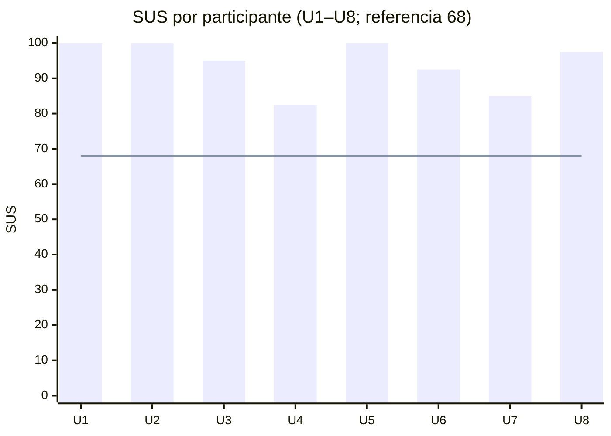

# Validación con usuarios (TRL 5) — Proyecto de Grado UNAD

Protocolo para validar el prototipo en un entorno relevante. Fuente de datos: telemetría de la
plataforma (`v_attempts`, ver `ACCOUNTS.md`) más un formulario post-uso.

## Protocolo (por participante, 20–30 min, remoto)

1. Crea su cuenta en la edición académica (`?edition=academic` o el deploy de `proyecto-grado`).
   El admin la aprueba en Supabase (`profiles.approved = true`).
2. Resuelve en **Práctica** al menos 3 ejercicios ejecutables (SQL o Python), usando pistas si las necesita.
3. Presenta **1 simulacro** en **Examen** (5 preguntas, cualquier categoría ejecutable).
4. Responde el formulario post-uso (abajo).

Criterio de inclusión: profesional o estudiante avanzado de un rol de datos en Colombia.
Meta: ≥ 15 participantes con al menos un simulacro completado (lograda: 8; ver Resultados).

## Formulario post-uso (Google Forms)

**Consentimiento** (obligatoria): «Acepto participar voluntariamente en la validación académica del
prototipo Dojo-DE (UNAD). Mis respuestas y mi uso de la plataforma se analizan de forma agregada y
anónima, conforme a la Ley 1581 de 2012.» — Sí / No

**Caracterización**
- Correo con el que se registró en Dojo-DE (solo para cruzar con la telemetría; no se publica)
- Rol: Ingeniería de datos · Analítica de datos · Analytics engineering · Ciencia de datos · Estudiante · Otro
- Años de experiencia: 0–1 · 2–4 · 5–9 · 10+
- Situación: Empleado · En búsqueda · En formación

**SUS — System Usability Scale** (Brooke, 1996). Escala 1 = Totalmente en desacuerdo … 5 = Totalmente de acuerdo.
1. Creo que me gustaría usar esta plataforma con frecuencia.
2. Encontré la plataforma innecesariamente compleja.
3. Pensé que la plataforma era fácil de usar.
4. Creo que necesitaría el apoyo de un técnico para poder usarla.
5. Encontré que las funciones de la plataforma estaban bien integradas.
6. Pensé que había demasiada inconsistencia en la plataforma.
7. Imagino que la mayoría de las personas aprendería a usarla muy rápidamente.
8. Encontré la plataforma muy engorrosa de usar.
9. Me sentí muy seguro(a) usando la plataforma.
10. Necesité aprender muchas cosas antes de poder usar la plataforma.

Cálculo: impares → (respuesta − 1); pares → (5 − respuesta); suma × 2,5 = puntaje 0–100.
Referencia: 68 = promedio de la industria.

**Utilidad percibida** (1–5)
11. El diagnóstico del error me ayudó a entender por qué falló mi solución.
12. Las pistas progresivas me ayudaron a avanzar sin ver la solución completa.
13. El reporte por categoría del simulacro me mostró con claridad mis brechas.
14. Recomendaría la plataforma para prepararse para una prueba técnica de datos.

**Abiertas**
15. ¿Qué fue lo más útil?
16. ¿Qué mejorarías o qué te faltó?

## Indicadores (Resultados esperados, Tabla 11)

| Indicador | Meta | Fuente |
|---|---|---|
| Participantes con ≥ 1 simulacro | ≥ 15 | `v_attempts` (`mode = 'e'`) |
| Puntaje SUS medio | ≥ 68 | Formulario 1–10 |
| Valoración ≥ 4 en ítem 14 | ≥ 80 % | Formulario 14 |
| Retroalimentación < 2 s | 100 % de corridas una vez cargado el motor | `exec_ms` en `v_attempts` |
| Exactitud de calificación | ≥ 90 % frente a revisión manual | Muestra de 20 intentos revisados a mano |

## Resultados (20–22 nov 2026)

Muestra: 8 usuarios externos (U1–U8) + prueba alfa del autor (reportada aparte); cuenta del tutor excluida.

| Indicador | Meta | Resultado | Estado |
|---|---|---|---|
| Participantes con ≥ 1 simulacro | ≥ 15 | 8 (11 simulacros) | No cumplido — suficiente para fines formativos (Nielsen y Landauer, 1993) |
| Puntaje SUS medio | ≥ 68 | 94,1 (mediana 96,3 · DE 6,9 · mín. 82,5) | Cumplido |
| Valoración ≥ 4 en ítem 14 | ≥ 80 % | 100 % (todos 5) | Cumplido |
| Retroalimentación < 2 s | 100 % con motor cargado | 76/77 corridas (98,7 %); la excepción incluye la carga de Pyodide · p50 2 ms · p95 33 ms | Cumplido |
| Exactitud de calificación | ≥ 90 % | No medida: la telemetría no guarda el código; verificada en CI con 103/103 soluciones de referencia | Limitación |

Telemetría: 104 intentos (49 práctica: 30 SQL + 19 Python · 55 examen); 21 de 23 fallos de código con diagnóstico (91 %);
9/9 pares usuario–ejercicio con fallo en práctica terminaron resueltos; 6 de 8 usuarios usaron pistas (21 pistas, 9/12 intentos con pista exitosos).

Mejoras pedidas (preguntas abiertas): más ejercicios ejecutables (series de tiempo, JSON anidado, cohortes, modelado dimensional),
dialectos reales (PostgreSQL/DuckDB, dbt), planes de ejecución, exportar el reporte del examen y una ruta introductoria.
